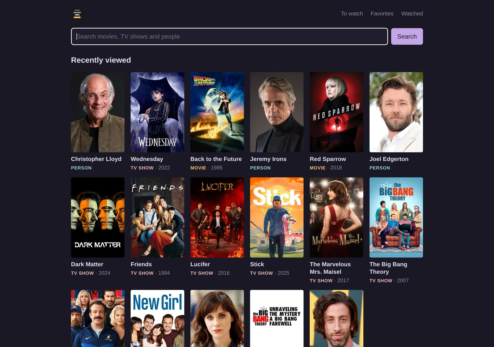
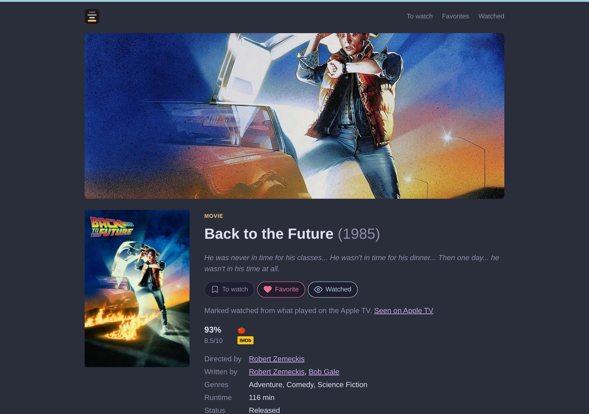
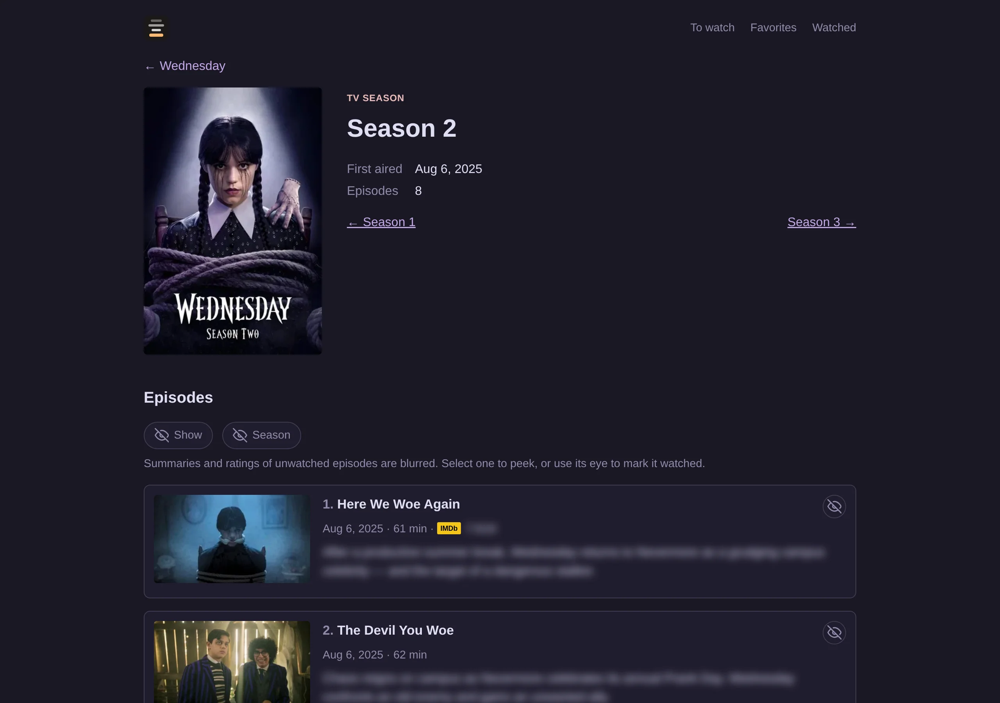
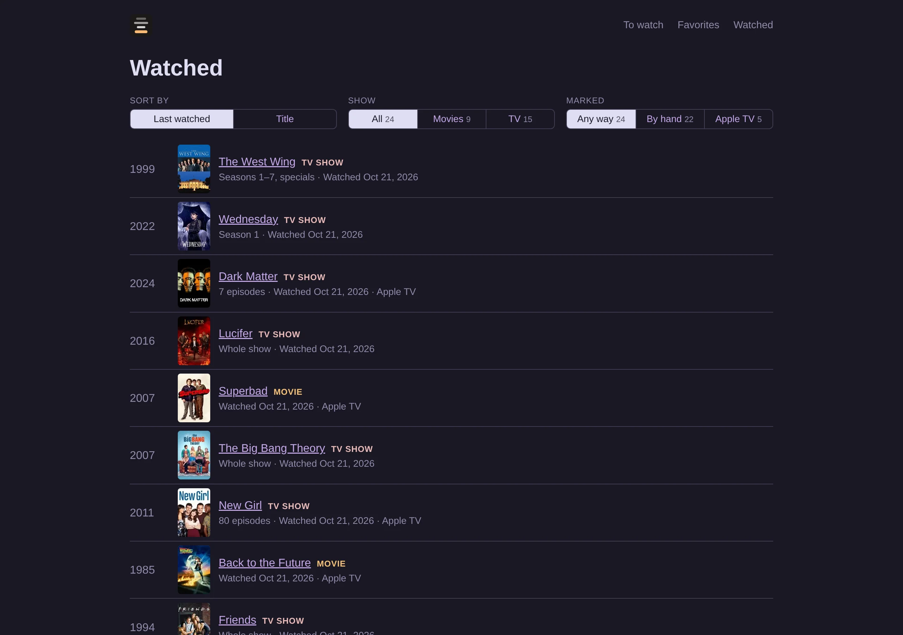

# credits

A personal movie and TV browser: search TMDB, see ratings and where to
watch, and keep track of what you've watched, without spoilers.



| | |
|---|---|
|  |  |



## Features

- **Search and browse** movies, shows, seasons, episodes and people,
  with full credits and filmographies
- **Ratings** from Rotten Tomatoes and IMDb (via OMDb)
- **Where to watch** in your region, highlighting your services
- **To watch, Favorites and Watched** lists with filter and sort
- **Now playing and Coming soon** movies in your region, with dates and ratings
- **Spoiler guard:** unwatched episode summaries, scores and actors'
  episode counts stay hidden
- **Seen on Apple TV:** optional, marks what you watch via Home Assistant
- **Survives outages:** serves stale cached data, and says when
  something can't be loaded rather than showing it empty
- **Themes:** Rosé Pine, Tokyo Night, Catppuccin, Classic
- **Terminal client** (`credits`) with the same features over the API
- **JSON API** under `/api/…` for every page, described by
  [`openapi.json`](openapi.json)

## Run

```sh
doppler secrets set TMDB_API_TOKEN --project credits --config dev
doppler secrets set OMDB_API_KEY --project credits --config dev   # optional
mise run dev   # web on http://127.0.0.1:3000
mise run tui   # terminal client
```

| Variable | Default | Purpose |
|----------|---------|---------|
| `TMDB_API_TOKEN` | required | TMDB API Read Access Token |
| `OMDB_API_KEY` | unset | Ratings |
| `CREDITS_BIND` | `127.0.0.1:3000` | Listen address (no auth: keep it local) |
| `CREDITS_DB` | `./credits.db` | SQLite cache and lists |
| `CREDITS_REGION` | `US` | Country for where to watch and release dates |
| `HA_URL`, `HA_TOKEN` | unset | Home Assistant, enables Seen on Apple TV |
| `CREDITS_HA_PLAYERS` | `media_player.living_room_appletv` | Players to follow |

The terminal client reads `~/.config/credits/config.toml`:

```toml
url = "https://credits.jallen7usa.com"
theme = "rose-pine"   # optional; press ? in the app for keys
```

## Develop

```sh
mise run test      # fake TMDB and OMDb; no keys needed
mise run openapi   # regenerate openapi.json (never edit it by hand)
mise run hooks     # pre-commit hook that keeps openapi.json in sync
nix flake check    # what CI runs
```

Rust (Axum, Askama, SQLx) with vendored HTMX; no Node build.

This product uses the TMDB API but is not endorsed or certified by TMDB.
Ratings via the [OMDb API](https://www.omdbapi.com/).
